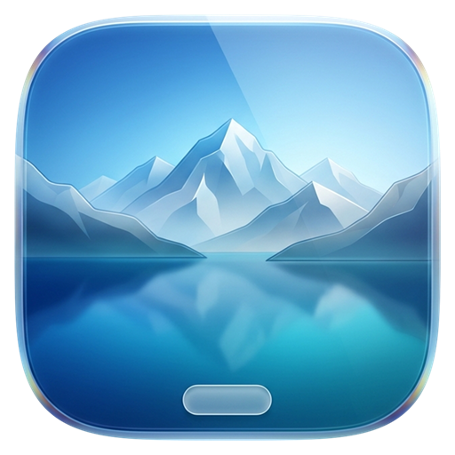

<p align="center">
  
</p>

<h1 align="center">TahoeDesk</h1>

<p align="center">
  面向 Windows 11 的轻量级 <b>macOS Tahoe (26+) 液态玻璃（Liquid Glass）</b> 桌面壳<br/>
  纯 C# <code>.NET 8</code> + WPF + DXGI / Direct3D 11 HLSL 着色器 · 零 DLL 注入 · 看门狗自愈保护
</p>

---

- **零 DLL 注入**：不注入 `explorer.exe` 或任何第三方进程，不修改系统文件，无需管理员权限。
- **看门狗自愈保护**：独立 `TahoeDesk.Watchdog.exe` 守护进程，异常崩溃或强杀时毫秒级自动恢复 Windows 原生任务栏与自动隐藏状态。
- **低占用高流畅**：共享单次编译的 D3D11 HLSL 液态玻璃管线、按需懒加载 DXGI 抓屏、关闭弹窗/启动台自动释放显存与视觉树、常驻运存低至约 **30–50 MB**。

---

## 核心特性

### 1. 顶部全局菜单栏（Menu Bar）
- **左侧**：
  - 左键点击 Windows 图标：关于本机、系统设置、强制退出、睡眠/重启/关机/锁屏/注销、退出 TahoeDesk。
  - **右键点击 Windows 图标**：完整原版 Windows 11 开始右键菜单（Win+X：已安装的应用、设备管理器、磁盘管理、终端/管理员终端、任务管理器、运行、桌面等）。
  - **静默前台应用全局菜单**：自动提取当前活动窗口菜单（Win32 `GetMenu` → 静态 UIA → 高频应用 JSON 配置表 → 通用菜单）。
- **右侧**：
  - **零注入系统托盘**：支持 `Shift + 左键` 在顶栏与折叠收纳区之间自由切换，折叠区支持拖拽排序与一键重同步，自动隐藏冗余系统电源/声音图标。
  - **实时输入法与大小写指示**（`中` / `英` / `⇪A`）：左键切换中英文，右键切换键盘布局。
  - **电池与电源模式**：电池胶囊内嵌百分比显示，支持一键切换最佳能效 / 平衡 / 最佳性能电源计划。
  - **控制中心（Control Center）**：Wi-Fi 列表直连、蓝牙开关与设备列表、流畅亮度/音量滑块、WinRT 媒体播放卡片、调度中心 (`Win+Tab`)、深浅主题切换。
  - **精简日历卡片**：点击时间展开日历并可快捷呼出系统通知中心。

### 2. 底部程序坞（Dock）
- **120fps 高斯波浪放大 + 弹簧弹跳 + 实时 DXGI 液态玻璃胶囊**。
- **独立多屏智能避让**：每个显示器各自判断最大化/全屏窗口，有最大化或全屏窗口时自动隐藏，鼠标触底顺滑弹出。
- **未读消息红点徽标与托盘常驻联动**：自动捕捉窗口闪烁（`HSHELL_FLASH`）与微信/QQ 等托盘图标闪烁；关闭到托盘的应用（如微信）保持 Dock 运行状态，点击直接唤回原窗口。
- **完整交互**：左键启动台打开 TahoeDesk 启动台，**右键启动台弹出原版 Windows 开始菜单**；支持拖入固定 `.exe`/`.lnk`/文件夹、下载文件夹堆栈浮窗、向上拖出取消固定、右键移除最近使用、拖拽文件到图标打开、可选 Squircle 图标统一美化。

### 3. 启动台（Launchpad）与聚焦搜索（Spotlight）
- **启动台**（单按 `Win` 键或点击 Dock 启动台；所有 `Win+E / Win+D / Win+Shift+S` 等组合键完整保留）：
  - 全量枚举 `shell:AppsFolder`（Microsoft Store / UWP / MSIX + Win32）及开始菜单/桌面快捷方式，支持手动添加本地 `.exe`/`.lnk`。
  - 支持自定义每页行列数、右键更换高清图标、一键添加到程序坞、主应用智能筛选、右键隐藏/恢复（按名称+ID 双重记忆）、自定义/名称/拼音排序、单图标精致小锁固定、`Ctrl+拖拽` 合并文件夹，以及**边缘停留/滚轮跨页拖拽排序**。
- **聚焦搜索**（`Alt + Space`）：支持应用模糊与拼音首字母搜索、即时算式计算（回车复制）、系统命令、本地文件索引及默认浏览器网页搜索兜底。

### 4. 动态环境自愈
- 自动监听外接屏热插拔、分辨率与 DPI 缩放变更、锁屏解锁和休眠唤醒，自动重建多屏菜单栏/Dock/AppBar 并恢复 DXGI 液态玻璃采样器。

---

## 运行环境要求

- Windows 11 (22H2 / 23H2 / 24H2，x64)
- [.NET 8 Desktop Runtime (x64)](https://dotnet.microsoft.com/download/dotnet/8.0)（便携版需安装；独立打包版内置运行时）

---

## 从源码构建与打包

```powershell
# 1. 构建 Release
dotnet build TahoeDesk.sln -c Release

# 2. 运行单元测试
dotnet test tests/TahoeDesk.Core.Tests -c Release --no-build

# 3. 打包绿色便携版 ZIP（输出到 dist/TahoeDesk-v1.0.1-win-x64-portable.zip）
.\scripts\build-portable.ps1

# 可选：打包免装 .NET 运行时的独立版本
.\scripts\build-portable.ps1 -SelfContained
```

---

## 应急恢复 Windows 原生任务栏

TahoeDesk 正常退出或异常崩溃时均会自动恢复原生任务栏。如遇极端情况，可运行便携包根目录的 `RestoreTaskbar.cmd` 或执行：

```powershell
TahoeDesk.exe --restore-taskbar
```

---

## 贡献与开源协议

- 欢迎为常用 Windows 应用补充全局菜单配置，详见 [应用菜单配置贡献指南](docs/CONTRIBUTING-MENU-PROFILES.md)。
- 本项目基于 [MIT License](LICENSE) 开源。
